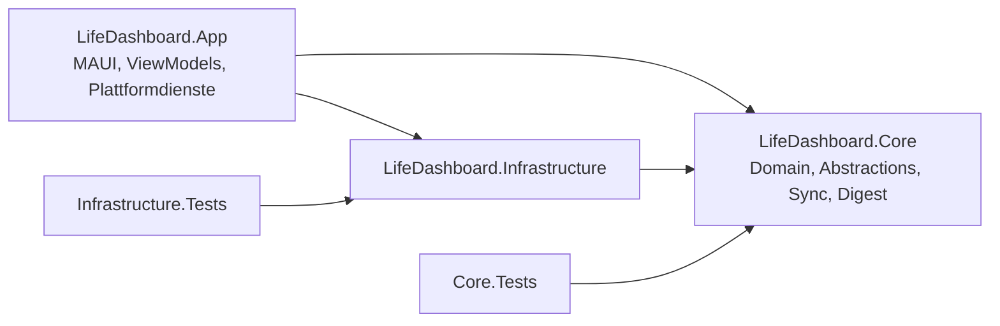

# Architektur

## Überblick

```
src/
  LifeDashboard.Core            Domain + Anwendungslogik (keine MAUI-/Plattform-/Infrastructure-Referenzen)
  LifeDashboard.Infrastructure  Konkrete Implementierungen (Graph, Google, Strava, Märkte, Export, Persistenz, DI)
  LifeDashboard.App             .NET MAUI UI (Windows + iOS)
tests/
  LifeDashboard.Core.Tests            reine Unit-Tests des Kerns
  LifeDashboard.Infrastructure.Tests  Mapper, Export, HTTP-Provider, DI-Container
```



**Abhängigkeiten zeigen nach innen.** `Core` kennt weder `Infrastructure` noch `App`.
`Core` referenziert ausschließlich `Microsoft.Extensions.Logging.Abstractions`.

## Core

| Ordner | Inhalt |
|---|---|
| `Domain/` | `CalendarEvent`, `EventSchedule` (`TimedSchedule` / `AllDaySchedule`), `CalendarInfo`, `CalendarAccount`, `SportActivity`, `MarketQuote`, `LedgerEntry`, `SyncRunRecord`, `OriginMarker`, `DateRange` |
| `Abstractions/` | `ICalendarProvider`, `ICalendarWriter`, `IActivityProvider`, `IMarketDataProvider`, `ISyncLedger`, `IExportService`, `INotificationService`, `ISecureTokenStore`, `IClock`, `IAccountConnector` |
| `Sync/` | `SyncEngine`, `SyncPlan`/`SyncAction`, `SyncRules`, `ConflictResolver`, `CalendarWriteGate`, `EventMapping`, `DryRunReport` |
| `Digest/` | `DailyDigestBuilder` |
| `InMemory/` | `InMemoryCalendarProvider`, `InMemorySyncLedger`, `InMemoryUserSettingsStore`: Referenzimplementierungen für Tests und den Demo-Modus |
| `Common/` | `Result`/`Result<T>`, `Error`, `Errors`, `Guard`, `SystemClock`, `ReadOnlyCalendarException` |

### Zeitmodell
- Alle Zeitpunkte sind intern **UTC** (`DateTimeOffset` mit Offset 0, erzwungen durch `Guard.Utc`).
- Die ursprüngliche Zeitzone wird separat gespeichert (`TimedSchedule.TimeZoneId`, IANA, z. B. `Europe/Vienna`).
- **Ganztagstermine** sind ein eigener Typ (`AllDaySchedule`) mit `DateOnly`, Ende exklusiv. Sie werden nie in UTC verschoben.

### Fehlerbehandlung
- Erwartbare Fehler (Netzwerk, nicht verbunden, nicht gefunden) liefern `Result.Failure(Error)`.
- Programmierfehler werfen Exceptions. Wichtigster Fall: `ReadOnlyCalendarException` beim Schreibversuch auf einen fremden Kalender.

## Infrastructure

| Ordner | Status |
|---|---|
| `Auth/` | `OAuthSession` (Authorization Code + PKCE, Token-Erneuerung, Tokens nur im sicheren Speicher), `LoopbackBrowser` (System-Browser + Rückleitung auf `http://127.0.0.1:<Port>` per TcpListener, ohne Admin-Rechte), `OAuthAccountConnector` |
| `MicrosoftGraph/` | `MicrosoftSession` (MSAL, Token-Cache im sicheren Speicher), `GraphCalendarProvider` (REST: calendars, calendarView mit Paging, POST/PATCH/DELETE, Marker als Single-Value Extended Property) |
| `GoogleCalendar/` | `GoogleCalendarProvider` (REST: calendarList, events mit `singleEvents` und Paging, Marker in `extendedProperties.private`), `GoogleOAuth` |
| `Common/` | `RestCalendarHelpers` (Bearer-Token, Fehlerabbildung 401/404/410, Marker-JSON, Windows→IANA) |
| `Ics/` | `IcsParser` (Ical.Net: Serien, EXDATE/RECURRENCE-ID, Windows→IANA-Zeitzonen, Ganztags) und `IcsCalendarProvider` (Abos aus den Einstellungen, URL aus dem sicheren Speicher, immer read-only), fertig und getestet |
| `Strava/` | Mapper fertig; Provider/Connector als Stub (Phase 5) |
| `Markets/` | `YahooFinanceMarketDataProvider` (inoffiziell, Standard), `FinnhubMarketDataProvider` (offiziell), `FallbackMarketDataProvider` (Yahoo → Finnhub pro fehlendem Symbol), `DemoMarketDataProvider` |
| `News/` | `FeedParser` (RSS 2.0, RDF, Atom; DTDs verboten), `NewsFeedCatalog` (Qualitätsmedien AT/DE/EU/international), `RssNewsProvider` (paralleles Laden, ETag/Last-Modified, Mindestabstand pro Feed) |
| `Export/` | `ExcelExportService` (ClosedXML), `CsvExportService` (CsvHelper), beide fertig |
| `Persistence/` | `SqliteDatabase` (Verbindung + Migrationen), `DatabaseSchema`, `SqliteSyncLedger`, `SqliteUserSettingsStore`, alle fertig und getestet |
| `Configuration/` | Options-Klassen |
| `Demo/` | Beispieldaten für den Demo-Modus |

> Die Ordner heißen `MicrosoftGraph`/`GoogleCalendar` statt `Microsoft`/`Google`. Ein Namespace
> `LifeDashboard.Infrastructure.Microsoft` würde sonst alle `Microsoft.Extensions.*`-Verweise im Projekt verdecken.

**DI:** `ServiceCollectionExtensions` stellt eine Extension-Methode pro Modul bereit (`AddLifeDashboardCore`,
`AddPersistence`, `AddCalendars`, `AddActivities`, `AddMarketData`, `AddExport`). `AddLifeDashboard` bündelt sie alle.

**HTTP:** Clients werden über `IHttpClientFactory` mit `AddStandardResilienceHandler()` erzeugt
(`Microsoft.Extensions.Http.Resilience`, basiert auf Polly v8). Der Handler bringt Retry mit exponentiellem Backoff
und Jitter mit, beachtet `Retry-After` bei HTTP 429 (wichtig für Strava), und enthält Circuit Breaker und Timeouts.

## App (MAUI)

- **MVVM** mit CommunityToolkit.Mvvm: `[ObservableProperty]` auf partial properties und `[RelayCommand]`.
  ViewModels orchestrieren nur, die Logik liegt in Core.
- **Navigation** über `AppShell`. Windows nutzt eine fest angedockte linke Leiste. iPhone nutzt Tabs unten
  (max. 5), die Einstellungen sind dort über das Zahnrad erreichbar (Push-Route `settings`).
- **Plattformdienste** in `Services/`: `MauiSecureTokenStore` (SecureStorage), `LocalNotificationService` (Stub)
  und `SyncCoordinator` (gemeinsamer Sync-Zustand für alle Seiten).
- **Konfiguration:** `appsettings.json` (eingecheckt) und optional `appsettings.Local.json` (gitignored) werden als
  Embedded Resources geladen.
- **Styles:** Farben in `Resources/Styles/Colors.xaml`, Stile in `Styles.xaml` (`Tile`, `PageTitle`, `TileTitle`,
  `BigNumber`, `Muted`, `Badge`, `PrimaryButton`, `SecondaryButton`). Hell und dunkel laufen über `AppThemeBinding`.
- **Kacheln:** `Controls/TileView`.

## Technologie-Entscheidungen

| Thema | Entscheidung | Begründung |
|---|---|---|
| .NET | 10 (LTS), MAUI 10.0.110 | aktuell stabil, langer Support |
| Persistenz | **sqlite-net-pcl 1.11** | schlank, auf iOS problemlos (kein EF-Interpreter-Modus nötig), Schema überschaubar. Ab 1.11 mit SQLitePCLRaw 3.x; das ältere `SQLitePCLRaw.bundle_green` 2.1.x enthält eine SQLite mit bekannter Sicherheitslücke |
| Excel | **ClosedXML** (MIT) | EPPlus ab v5 steht unter Polyform Noncommercial bzw. kommerzieller Lizenz |
| ICS | **Ical.Net 5** (MIT) mit NodaTime | RFC-5545-Serienlogik selbst zu bauen wäre fehleranfällig; Ical.Net kann RRULE, EXDATE, RECURRENCE-ID und Outlook-Zeitzonen |
| CSV | CsvHelper | Standard, `;` als Trenner für Excel im deutschsprachigen Raum |
| Marktdaten | **Yahoo Finance + Finnhub-Fallback** | Auf Wunsch des Nutzers Yahoo (beste Abdeckung für ATX/DAX/EU, aber inoffiziell/Grauzone); Finnhub (offiziell, 60 Req/min gratis, v. a. US) übernimmt fehlende Symbole und Ausfälle |
| News | **Offizielle RSS-Feeds + eigener Ranker** | Kein Scraping. Relevanz = Anzahl unabhängiger Zeitungen, die dieselbe Geschichte bringen, + Aktualität (`Core/News/HeadlineRanker`); nachvollziehbar und ohne Kosten (keine KI) |
| Assertions | FluentAssertions **7.x** | ab v8 kommerzielle Lizenz (Xceed); 7.x ist Apache-2.0 |
| Resilienz | Microsoft.Extensions.Http.Resilience | offizielle Polly-v8-Integration für HttpClientFactory. Für Kalender-APIs `DisableForUnsafeHttpMethods()` (ein wiederholtes POST könnte Termine doppelt anlegen), Token-Endpunkte ganz ohne Retry (Codes sind einmalig) |
| Kalender-APIs | **REST statt Graph-/Google-SDK** | nur ~6 Endpunkte nötig; SDKs bringen > 50 MB und erschweren Tests sowie iOS-Trimming |
| Microsoft-Login | **MSAL.NET** (MIT) | offizielle Bibliothek, System-Browser, stille Token-Erneuerung |
| Google-/Strava-Login | eigener OAuth-Ablauf | RFC 8252 (Loopback + PKCE), kein zusätzliches Paket nötig |
