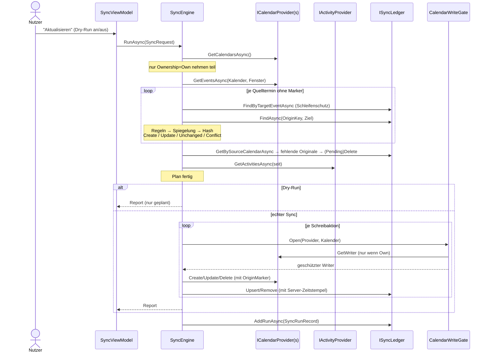

# Sync-Design

Implementierung: `src/LifeDashboard.Core/Sync/SyncEngine.cs`. Tests: `tests/LifeDashboard.Core.Tests/Sync/SyncEngineTests.cs`.

## Regeln

| # | Regel | Umsetzung | Test |
|---|---|---|---|
| R1 | **Nur in eigene Kalender schreiben.** Kalender von Vorgesetzten/Kollegen sind strikt read-only. | Dreifach abgesichert: (1) `SyncEngine` nimmt nur `CalendarOwnership.Own` in die Spiegelung auf. (2) `CalendarWriteGate.Open` prüft die Eigentümerschaft **bevor** der Provider gefragt wird und kapselt den Writer so, dass jede einzelne Operation erneut geprüft wird (auch gegen fehlerhafte Provider). (3) Jeder Provider wirft selbst `ReadOnlyCalendarException` in `GetWriter`. | `Shared_calendar_is_never_written…`, `Write_gate_rejects…`, `Write_gate_blocks_buggy_provider…`, `Ics_provider_never_hands_out_writer…` |
| R2 | **Idempotenz**: mehrfaches Syncen erzeugt keine Duplikate. | Ledger-Schlüssel `(OriginKey, TargetCalendarId)` und Inhalts-Hash. Gleicher Hash → `Unchanged`, kein Schreibzugriff. | `Syncing_twice_creates_no_duplicates` |
| R3 | **Schleifenschutz** (A→B→A). | Jede Spiegelung trägt einen `OriginMarker` (`OriginProvider`, `OriginId`, `SyncHash`). Termine mit Marker sind nie Quelle. Zusätzlich gilt ein Termin, den das Ledger als Ziel kennt, nie als Quelle, auch wenn der Marker verloren ging. | `Mirrors_carry_origin_marker…`, `Mirror_that_lost_its_marker…` |
| R4 | **Sync-Ledger** in SQLite. | `ISyncLedger`; Schema siehe unten. Bis Phase 1 läuft `InMemorySyncLedger`. | |
| R5 | **Konflikte**, Default „zuletzt geändert gewinnt“, wird protokolliert. | `ConflictResolver`, Strategien `LastModifiedWins` / `SourceWins` / `TargetWins`. Ein Konflikt liegt vor, wenn der **Server-Zeitstempel** der Spiegelung neuer ist als der Zeitstempel, den der Server bei unserem letzten Schreiben gemeldet hat (`WriteReceipt`). So spielt Uhrabweichung keine Rolle. | `Conflict_last_modified_wins_*` |
| R6 | **Löschungen** nur bei vom Ledger bekannten Spiegelungen, standardmäßig erst nach Bestätigung. | Fehlt ein Original im Fenster, wird `PendingDeleteConfirmation` geplant. Gelöscht wird erst mit `ConfirmDeletes = true`. Fremde Termine stehen nie im Ledger und werden daher nie gelöscht. Kalender, die nicht geladen werden konnten, gelten **nicht** als leer. | `Deleted_original_*`, `Events_not_created_by_the_app…`, `Failed_calendar_load_does_not_delete_mirrors` |
| R7 | **Dry-Run** zeigt eine Vorschau, ohne zu schreiben. | `SyncRequest.DryRun` (Default `true`). Es wird nur geplant, der Report enthält alle Aktionen mit `Outcome = Planned`. | `Dry_run_plans_changes_but_writes_nothing`, `Dry_run_after_real_sync_reports_pending_delete…` |
| R8 | **Datenschutz** zwischen privat und beruflich. | `SyncRules`: privat↔privat und Arbeit↔Arbeit spiegeln voll, privat↔Arbeit nur `BusyOnly` („Beschäftigt“, ohne Titel, Ort und Beschreibung). Als privat markierte Termine bleiben immer `BusyOnly`, als „frei“ markierte werden nicht gespiegelt. | `Private_to_work_mirror_contains_no_details…`, `Private_event_is_busy_only…` |
| R9 | **Strava** einmal pro Aktivität, bei Änderungen Update. | Ledger-Schlüssel `act\|Strava\|{ActivityId}`. Derselbe Upsert-Pfad wie bei Terminen. | `Activities_are_imported_once_and_updated_on_change` |

## Ablauf

## Herkunftsmarker in den Fremdsystemen

| Anbieter | Speicherort |
|---|---|
| Google | `extendedProperties.private`: `LifeDashboard.OriginProvider`, `LifeDashboard.OriginId`, `LifeDashboard.SyncHash` |
| Microsoft Graph | Single-Value Extended Property `String {6f8b2a9e-3c1d-4e57-9a0b-2d4c6e8f1a3b} Name LifeDashboard.Origin`, Wert ist JSON `{OriginProvider, OriginId, SyncHash}` (siehe `GraphCalendarProvider.OriginPropertyId`). Single-Value statt Open Extension, weil sich Single-Value Properties per `$filter` abfragen lassen. |

## Ledger-Schema (SQLite, Phase 1)

Siehe `src/LifeDashboard.Infrastructure/Persistence/SqliteSyncLedger.cs` → `LedgerSchema`.

| Spalte | Bedeutung |
|---|---|
| `OriginKey` + `TargetCalendarId` | Primärschlüssel |
| `OriginProvider`, `SourceCalendarId`, `OriginNativeId` | Herkunft (`SourceCalendarId` ist bei Aktivitäten `NULL`) |
| `OriginStartUtc` | begrenzt Löschungen auf das Sync-Fenster |
| `TargetEventId` | ID der Spiegelung (Index für den Schleifenschutz) |
| `SyncHash` | Hash des zuletzt geschriebenen Inhalts |
| `TargetLastModifiedUtc` | Server-Zeitstempel nach unserem Schreiben (Konflikterkennung) |
| `LastSyncedUtc`, `Status` | Info |

Dazu kommen die Tabelle `SyncRun` (Historie für die Dashboard-Kachel) und `SchemaVersion`.

**Migrationsstrategie:** `LedgerSchema.Migrations` ist eine geordnete Liste von SQL-Skripten, die nur vorwärts laufen.
Beim Start wird `SchemaVersion` gelesen und alle fehlenden Skripte laufen in einer Transaktion. Bestehende Skripte werden
nie geändert, neue werden nur angehängt.

## Bekannte Grenzen (bewusst, später angehen)

- **Termin aus dem Fenster verschoben:** Ein Original, das aus dem Sync-Fenster heraus verschoben wurde, sieht aus
  wie gelöscht. Weil Löschungen standardmäßig erst bestätigt werden müssen, entsteht daraus kein Schaden. In Phase 4
  soll die Engine vor dem Löschen per Einzelabfrage (`GET event by id`) prüfen, ob das Original noch existiert.
- **Wiederkehrende Serien** werden als Einzeltermine gespiegelt (`singleEvents=true` / `calendarView`). Das ist
  einfach und robust, erzeugt aber eine Spiegelung pro Vorkommen.
- **Strava-Löschungen** werden nicht erkannt (die API liefert gelöschte Aktivitäten nicht).
- Ein Konflikt, bei dem die Zielseite gewinnt (`TargetWins`/neuer), wird bei jedem Lauf erneut gemeldet, bis sich
  das Original wieder ändert.
